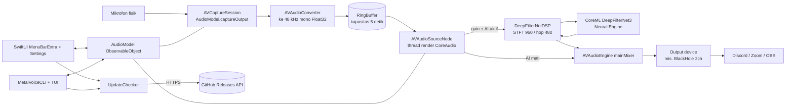

# MetalVoice: Overview Codebase

> Dibuat 16 November 2026 dari commit `f037130` (Release v1.2.5). Analisis ini tidak mengubah kode apa pun.
> Diverifikasi dengan `swift build -c release` (berhasil, Swift 6.4, macOS 27.0.1 arm64) dan `./bundle.sh` (berhasil, tanda tangan ad-hoc).

## Ringkasan

- **Apa ini:** aplikasi menu bar macOS (plus CLI terminal) yang menghapus noise dari mikrofon secara real-time memakai model AI DeepFilterNet3 yang berjalan lokal lewat CoreML.
- **Stack:** Swift + SwiftPM, SwiftUI/AppKit, AVFoundation/CoreAudio, Accelerate (vDSP), CoreML. Tanpa backend, database, auth, atau dependensi pihak ketiga.
- **Cara jalan:** `swift build -c release` lalu `./bundle.sh` lalu `open MetalVoice.app`. Butuh Mac Apple Silicon, macOS 13+, dan BlackHole 2ch.
- **PRD.md tidak ada di repo.** Tabel status memakai `README.md` (daftar fitur) dan `projectC.md` (catatan konteks proyek) sebagai pengganti.
- **Status:** fitur inti (noise suppression, pemilihan device, menu bar, CLI + dashboard, cek update) sudah jalan. Yang belum: notarisasi/Developer ID, tampilan error di UI, deteksi device hot-plug, tes, dan CI.
- **Bug utama:** gain dikalikan dua kali saat AI aktif; app crash (`fatalError`) bila file model tidak ditemukan; angka "per detik" di dashboard CLI salah; test tone berupa white noise padahal README menyebut 440 Hz; inferensi CoreML dan alokasi memori terjadi di thread audio real-time.
- **Prioritas tercepat ke produksi:** (1) perbaiki gain ganda dan `fatalError`, (2) rapikan `bundle.sh` (build, cek model, zip), (3) Developer ID + hardened runtime + notarisasi, (4) verifikasi integritas file update CLI, (5) tampilkan error/izin mikrofon di UI.

---

## 1. Aplikasi apa ini?

**MetalVoice** adalah aplikasi peredam noise berbasis AI untuk macOS. Aplikasi ini mengambil suara dari mikrofon, membersihkannya dari suara latar (kipas, ketikan keyboard, AC, obrolan di belakang), lalu mengirim hasilnya ke perangkat output. Biasanya output-nya kabel audio virtual seperti BlackHole, sehingga Discord, Zoom, atau OBS bisa memakai suara yang sudah bersih sebagai "mikrofon".

**Masalah yang diselesaikan:** macOS tidak punya peredam noise AI tingkat sistem yang bisa dipakai di semua aplikasi. MetalVoice mengisi celah itu dan berjalan 100% di perangkat, jadi audio tidak dikirim ke server.

**Target pengguna:**
- Pengguna Mac Apple Silicon (M1 atau lebih baru) yang sering rapat online, streaming, atau main game sambil voice chat.
- Pengguna mahir yang butuh CLI, misalnya untuk menjalankan dua pipeline sekaligus: mic sendiri dan audio lawan bicara.

**Dua cara pakai:**

| Mode | File utama | Keterangan |
|---|---|---|
| App menu bar (GUI) | `Sources/App/*.swift` | Ikon gelombang di menu bar. Memilih input/output, toggle AI, jendela Settings (gain, update, panduan). |
| CLI terminal | `Sources/CLI/main.swift` | `MetalVoiceCLI`. Bisa interaktif (pilih device + dashboard live) atau lewat flag (`--in`, `--out`, `--gain`, dan lain-lain). |

---

## 2. Tech stack

Kategori seperti backend, database, dan auth tetap dicantumkan supaya jelas bahwa memang **tidak ada**.

| Kategori | Yang dipakai | Versi / bukti |
|---|---|---|
| Bahasa | Swift (mode bahasa Swift 5) | `swift-tools-version:5.9` di `Package.swift`. Terverifikasi build dengan Swift 6.4. |
| Build system | Swift Package Manager (tanpa Xcode project) + skrip shell `bundle.sh` | `Package.swift`, `bundle.sh` |
| Platform minimum | macOS 13 Ventura, Apple Silicon (arm64) | `.macOS(.v13)` di `Package.swift`. `Float16` tidak tersedia di Mac Intel, jadi build Intel akan gagal. |
| Frontend / UI | SwiftUI (`MenuBarExtra`, `TabView`) + AppKit (`NSPanel`, `NSHostingView`) | `Sources/App/MetalVoiceApp.swift`, `ContentView.swift`, `SettingsView.swift` |
| UI library | Tidak ada library pihak ketiga. Ikon dari SF Symbols. | |
| TUI (CLI) | Kode ANSI escape + `termios` (raw mode) dari Darwin | `Sources/CLI/main.swift` |
| "Backend" / logika inti | Modul `Core` (library Swift statis) di dalam app. **Tidak ada server.** | `Sources/Core/` |
| Audio input | `AVCaptureSession` + `AVCaptureAudioDataOutput` + `AVAudioConverter` (konversi ke 48 kHz mono Float32) | `Sources/Core/AudioModel.swift` |
| Audio output | `AVAudioEngine` + `AVAudioSourceNode`, device dipilih via CoreAudio/AudioToolbox (`kAudioOutputUnitProperty_CurrentDevice`) | `AudioModel.swift` |
| DSP | Accelerate (vDSP DFT 960 titik, jendela sqrt-Hann, overlap-add, `cblas_sgemv` untuk filterbank ERB) | `Sources/Core/AudioProcessing/DeepFilterNetDSP.swift` |
| AI | Model **DeepFilterNet3 Streaming** dalam format CoreML `mlprogram` (spec v7, Float16), `computeUnits = .all` (CPU/GPU/Neural Engine). Dikonversi dengan coremltools 9.0 dari torch 2.9.1 (16 Des 2025). | `Resources/DeepFilterNet3_Streaming.mlmodelc/metadata.json` |
| AI service eksternal | **Tidak ada.** Semua inferensi lokal. | |
| Database | **Tidak ada.** Preferensi disimpan di `UserDefaults` (UID input, UID output, AI on/off, gain). | `AudioModel.swift` (key `mv.*`) |
| ORM | **Tidak ada.** | |
| Auth | **Tidak ada** login. Hanya izin mikrofon macOS (TCC) lewat `NSMicrophoneUsageDescription` + entitlement `audio-input`. | `Resources/Info.plist`, `Resources/MetalVoice.entitlements` |
| Jaringan | Hanya cek update ke GitHub REST API `releases/latest` dan unduh ZIP rilis. | `Sources/Core/UpdateChecker.swift` |
| Hosting / distribusi | GitHub Releases (file ZIP berisi `MetalVoice.app` + `MetalVoiceCLI`). Tanda tangan ad-hoc, belum notarisasi. | `README.md`, `bundle.sh` |
| Dependensi pihak ketiga | **Nol.** `dependencies: []` | `Package.swift` |
| Tooling tambahan | Python `coremltools` hanya untuk inspeksi model | `inspect_model.py` |
| Prasyarat runtime | BlackHole 2ch (kabel audio virtual, versi Homebrew saat ini 0.7.1) | `README.md` |

### Diagram arsitektur



Alurnya: mikrofon masuk ke antrean background, dikonversi ke 48 kHz mono, lalu ditulis ke `RingBuffer`. Thread render CoreAudio mengambil sampel dari `RingBuffer`, memberi gain, lalu (bila AI aktif) memproses per 10 ms (480 sampel) lewat STFT, model CoreML, dan ISTFT, kemudian mengirim hasilnya ke output device.

---

## 3. Cara menjalankan

### 3.1 Prasyarat

1. Mac **Apple Silicon** (M1/M2/M3/M4 atau lebih baru) dengan **macOS 13** atau lebih baru.
2. **Swift 5.9+**. Cukup Command Line Tools, tidak wajib Xcode:
   ```bash
   xcode-select --install
   swift --version
   ```
3. **BlackHole 2ch** sebagai kabel audio virtual:
   ```bash
   brew install --cask blackhole-2ch
   ```
   Atau unduh dari https://existential.audio/blackhole/. Installer driver ini meminta **password admin**, jadi harus dijalankan di terminal interaktif. Setelah instalasi driver audio, logout/restart bila device belum muncul.
4. Git untuk clone repo.

### 3.2 Instalasi dan build

```bash
git clone https://github.com/Ghostkwebb/MetalVoice.git   # upstream; repo lokal ini memakai fork rdeeanz/MetalVoice
cd MetalVoice

# 1. Build release (WAJIB sebelum bundle.sh, karena bundle.sh tidak menjalankan build)
swift build -c release

# 2. Rakit MetalVoice.app + salin CLI ke root repo + tanda tangan ad-hoc
./bundle.sh

# 3. Jalankan app menu bar
open MetalVoice.app
```

Catatan penting:
- **Jangan** menjalankan `.build/release/MetalVoice` langsung untuk GUI. Binary tanpa bundle `.app` tidak membawa `Info.plist` (izin mikrofon) dan tidak menemukan file model.
- `Package.swift` mendeklarasikan `resources: ["../../Resources"]`, tetapi SwiftPM **mengabaikannya** karena folder itu di luar folder target (dicek dengan `swift package describe`: tidak ada resource yang terdaftar). Model hanya ditemukan lewat `bundle.sh` atau fallback path.

### 3.3 Setup "env" dan konfigurasi

- **Tidak ada file `.env`, API key, atau secret.** Semua berjalan lokal.
- Konfigurasi pengguna tersimpan di `UserDefaults`. Nilai baru ditulis setelah pengguna **mengubah** sesuatu (pilih device, toggle AI, geser gain). Pada launch pertama, `defaults read com.ghostkwebb.MetalVoice` masih menjawab "Domain not found", dan itu normal.
  - App: domain `com.ghostkwebb.MetalVoice`, key `mv.selectedInputUID`, `mv.selectedOutputUID`, `mv.isAIEnabled`, `mv.outputGain`.
  - Reset pengaturan app: `defaults delete com.ghostkwebb.MetalVoice`
  - CLI memakai domain `UserDefaults` sendiri, terpisah dari app.
- Izin mikrofon: saat pertama kali dibuka, macOS meminta izin. Bila sempat ditolak, buka **System Settings → Privacy & Security → Microphone** lalu aktifkan MetalVoice (atau Terminal, untuk CLI).
- Versi app diatur di `Resources/Info.plist` (`CFBundleShortVersionString` = 1.2.5, `CFBundleVersion` = 9).

### 3.4 Pemakaian GUI

1. Klik ikon gelombang di menu bar.
2. **Input Device**: pilih mikrofon fisik.
3. **Output Device**: pilih `BlackHole 2ch` (otomatis terpilih bila ada dan belum pernah disimpan).
4. Di Discord/Zoom/OBS, set mikrofon ke `BlackHole 2ch`.
5. Nyalakan toggle **DeepFilterNet AI**.

### 3.5 Pemakaian CLI

```bash
# Interaktif (pilih device dengan angka, lalu dashboard live)
./MetalVoiceCLI

# Langsung lewat flag (nama device dicocokkan sebagian, tidak peka huruf besar/kecil)
./MetalVoiceCLI --in "MacBook Pro Microphone" --out "BlackHole 2ch" --gain 1.0

# Opsi lain
./MetalVoiceCLI --ai false      # tanpa AI (passthrough)
./MetalVoiceCLI --tone          # sinyal uji (saat ini white noise)
./MetalVoiceCLI --log           # log bergulir, bukan dashboard
./MetalVoiceCLI --check-update
./MetalVoiceCLI --update
./MetalVoiceCLI --help
```

Agar CLI menemukan model, jalankan dari **root repo** (fallback `Resources/...`) atau letakkan `MetalVoiceCLI` **di sebelah** `MetalVoice.app`. Bila tidak ketemu, proses langsung crash (lihat bug B2).

Hotkey dashboard: `Q` keluar, `A` AI on/off, `T` test tone, `+`/`-` gain, `H` mode log, `U` upgrade (bila ada versi baru).

### 3.6 Debug dan rilis

```bash
# Lihat log NSLog dari app
log stream --predicate 'process == "MetalVoice"' --level debug

# Paket rilis (manual, bundle.sh tidak membuat zip)
zip -r MetalVoice_v1.2.5.zip MetalVoice.app MetalVoiceCLI
```

Repo belum punya tes otomatis dan CI.

---

## 4. Status pekerjaan

**PRD.md tidak ditemukan** di repo (dicek dengan `find . -iname 'PRD*'`). Sebagai pengganti, kolom "fitur/pekerjaan" diambil dari:
- `README.md` bagian Features, CLI, dan Tech Stack (janji ke pengguna), dan
- `projectC.md` (dokumen konteks untuk AI agent yang berisi arsitektur dan changelog v1.0 sampai v1.2).

Status: **Selesai** = ada di kode dan masuk akal secara logika. **Sebagian** = ada tapi kurang lengkap atau tidak sesuai klaim. **Belum** = tidak ada di kode. Status ini berdasarkan pembacaan kode dan build; audio tidak diuji end-to-end dengan mikrofon.

| # | Fitur / pekerjaan | Status | Bukti (path) | Catatan |
|---|---|---|---|---|
| 1 | Noise suppression real-time DeepFilterNet3 | Selesai | `Sources/Core/AudioProcessing/DeepFilterNetDSP.swift`, `Resources/DeepFilterNet3_Streaming.mlmodelc/` | STFT 960/hop 480, inferensi per 10 ms. Berjalan di thread render audio (lihat B5). |
| 2 | De-reverberation ("Studio Clarity") | Sebagian | `DeepFilterNetDSP.swift` | Tidak ada kode khusus. Bergantung sepenuhnya pada perilaku model, dan tidak ada tes yang membuktikannya. |
| 3 | "Zero latency feel" | Sebagian | `Sources/Core/AudioModel.swift` (baris 194-206), `DeepFilterNetDSP.swift` | Ada pre-roll DSP 20 ms, akumulasi frame, dan jitter buffer yang baru di-drop di atas ~100 ms. Latensi belum pernah diukur. |
| 4 | 100% on-device / privasi | Selesai | `DeepFilterNetDSP.swift`, `UpdateChecker.swift` | Audio tidak keluar dari Mac. Satu-satunya akses jaringan adalah cek update ke GitHub. |
| 5 | Mendukung mikrofon apa pun (USB, interface XLR, built-in) | Sebagian | `AudioModel.swift` (`fetchInputDevices`, `captureOutput`) | Format apa pun dikonversi ke 48 kHz mono. Daftar device hanya dibaca saat start (tidak ada hot-plug). Input multi-channel di-downmix oleh `AVAudioConverter` tanpa pilihan channel. |
| 6 | Output ke device apa pun / kabel virtual | Selesai | `AudioModel.swift` (`fetchOutputDevices`, `setupPlaybackEngine`) | Device diset via `kAudioOutputUnitProperty_CurrentDevice`. Status `AudioUnitSetProperty` tidak dicek. |
| 7 | App menu bar (ikon, picker device, toggle AI, meter) | Selesai | `Sources/App/MetalVoiceApp.swift`, `Sources/App/ContentView.swift` | `LSUIElement` + `.accessory`, jadi tidak ada ikon di Dock. |
| 8 | Jendela Settings (gain, update, panduan) | Selesai | `Sources/App/SettingsView.swift` | Slider gain 0.5x sampai 4.0x. |
| 9 | Simpan pilihan device, AI, gain antar-launch | Selesai | `AudioModel.swift` (key `mv.*`, guard `isRestoringDefaults`) | Output disimpan via UID CoreAudio yang stabil. |
| 10 | Automatic updates dari App | Sebagian | `SettingsView.swift`, `UpdateChecker.swift` | App hanya menampilkan tombol "Download" ke ZIP. Tidak ada instalasi otomatis. |
| 11 | Automatic updates dari CLI (`--update`, hotkey `U`) | Selesai | `UpdateChecker.swift` (`updateCLIBinary`), `Sources/CLI/main.swift` | Hanya mengganti binary CLI, bukan `.app`. Tanpa verifikasi checksum/tanda tangan (lihat B8). |
| 12 | CLI interaktif (pilih device dengan angka) | Selesai | `Sources/CLI/main.swift` (baris 206-282) | Mic default diurutkan ke nomor 1, device virtual ke bawah. |
| 13 | Flag CLI `--in --out --gain --ai --tone --log --check-update --update --version --help` | Selesai | `Sources/CLI/main.swift` (baris 74-124) | Flag yang tidak dikenal diabaikan tanpa pesan. |
| 14 | Dashboard TUI live (VU meter, buffer, status) | Sebagian | `Sources/CLI/main.swift` (baris 320-433), `AudioModel.getDiagnosticsSnapshot` | Tampil, tetapi angka "pkts/s", "renders/s", drops, dan underruns sebenarnya per ~60 ms, bukan per detik (B3). |
| 15 | Test tone 440 Hz | Sebagian | `AudioModel.swift` baris 184 | Kode menghasilkan white noise acak ±0.1, bukan sinus 440 Hz seperti di README baris 96. |
| 16 | Hotkey Q/A/T/+/-/H/U | Selesai | `Sources/CLI/main.swift` (baris 336-380) | |
| 17 | Dual pipeline (dua proses CLI terpisah) | Selesai | `projectC.md` §7, `Sources/CLI/main.swift` | Caranya dengan menjalankan dua instance CLI. Belum ada bukti uji. |
| 18 | Restart engine saat konfigurasi berubah (mis. HFP Bluetooth) | Selesai | `AudioModel.swift` (`handleEngineConfigurationChange`, baris 267-285) | Notifikasi beruntun digabung dengan debounce 0.5 detik. |
| 19 | Setup engine di luar main thread | Selesai | `AudioModel.swift` (`engineQueue`, `setupPlaybackEngine`) | Flag `isReconfiguringEngine` dibaca dari dua thread tanpa lock. |
| 20 | Optimasi hot path DSP (buffer MLMultiArray dialokasi sekali) | Sebagian | `DeepFilterNetDSP.swift` (init, `processHop`) | MLMultiArray sudah dipakai ulang, tetapi masih ada puluhan alokasi `Array`, `removeFirst`, dan `NSNumber` per hop. |
| 21 | Fallback Float16 untuk macOS 13-14 | Selesai | `DeepFilterNetDSP.swift` (`#available(macOS 15.0, *)`) | |
| 22 | Pencarian model di beberapa lokasi (app, CLI, app di sebelahnya) | Selesai | `DeepFilterNet3_Streaming.swift` (`urlOfModelInThisBundle`) | Bila semua gagal, `fatalError` (B2). |
| 23 | Resource SwiftPM di `Package.swift` | Belum | `Package.swift` baris 18-19 dan 33-34 | Diabaikan SwiftPM karena path di luar target. Konfigurasi ini tidak berfungsi. |
| 24 | `bundle.sh` menjalankan build dan membuat ZIP (klaim `projectC.md` §2, §8) | Sebagian | `bundle.sh` | Skrip hanya menyalin dan menandatangani. Tidak menjalankan `swift build`, tidak membuat zip, tidak `set -e`, dan model yang hilang hanya di-skip. |
| 25 | Skrip ekspor model `export_coreml.py` | Belum | (file tidak ada) | Model tidak bisa dibuat ulang dari sumber. `inspect_model.py` merujuk `.mlpackage` yang juga tidak ada. |
| 26 | Code signing Developer ID + notarisasi | Belum | `bundle.sh` baris 26 | Masih ad-hoc (`--sign -`), tanpa hardened runtime. Pengguna mendapat peringatan Gatekeeper (README mengakuinya). |
| 27 | Tampilan error di UI | Belum | `ContentView.swift` baris 112, `AudioModel.swift` baris 35 | `AudioModel.errorMessage` tidak pernah diisi, jadi ikon error tidak pernah muncul. |
| 28 | Penanganan izin mikrofon | Sebagian | `AudioModel.checkPermissions` | Izin diminta, tetapi `permissionStatus` tidak ditampilkan. Bila ditolak, app diam saja tanpa petunjuk. |
| 29 | Hot-plug device (colok/cabut mic atau output) | Belum | `AudioModel.swift` | Tidak ada listener `kAudioHardwarePropertyDevices` atau notifikasi `AVCaptureDevice`. Harus restart app. |
| 30 | Batasan Apple Silicon / macOS 13 di metadata app | Sebagian | `Resources/Info.plist` | Belum ada `LSMinimumSystemVersion` dan `CFBundlePackageType`. |
| 31 | Tes otomatis dan CI | Belum | (tidak ada `Tests/` dan `.github/`) | |
| 32 | Dokumentasi konteks (`projectC.md`) akurat | Sebagian | `projectC.md` | Ada yang sudah usang: ambang latensi kini `2400*2 + count`, `.gitignore` tidak mengabaikan `*.mlmodelc`, ukuran model ~4,3 MB (bukan 20 MB), `UnitMagNormalizer` bukan file terpisah. File ini ada di `.gitignore` tetapi tetap ter-commit. |

---

## 5. Prioritas berikutnya, bug, dan potensi masalah

### 5.1 Bug yang ditemukan

| ID | Bug | Lokasi | Dampak | Saran perbaikan |
|---|---|---|---|---|
| B1 | **Gain dikalikan dua kali.** Gain dikalikan di render callback (`vDSP_vsmul`) lalu dikalikan lagi di ISTFT (`* outputGain`). Nilai awal `dspEngine.outputGain` juga tidak disinkronkan saat launch karena `didSet` tidak terpanggil untuk nilai awal. | `AudioModel.swift` baris 64 dan 223, `DeepFilterNetDSP.swift` baris 474 | Dengan AI aktif, gain 2x menjadi 4x setelah slider digeser (atau langsung di CLI `--gain 2`). Saat app baru dibuka, hasilnya 2x. Volume berubah-ubah dan mudah clipping. | Pakai satu tempat saja untuk gain, misalnya hapus `* outputGain` di DSP. |
| B2 | **Crash bila model tidak ditemukan.** `fatalError` di `urlOfModelInThisBundle`, dipanggil dari `Task` saat init DSP. | `DeepFilterNet3_Streaming.swift` baris 226 | CLI yang dijalankan dari folder lain (mis. `.build/release/MetalVoiceCLI`) langsung crash. | Lempar error, isi `errorMessage`, dan tetap jalan dalam mode passthrough. |
| B3 | **Statistik "per detik" salah.** Counter di-reset setiap snapshot, sedangkan snapshot diambil tiap 60 ms. | `AudioModel.swift` baris 134-140, `Sources/CLI/main.swift` baris 320 dan 382 | Angka pkts/s, renders/s, drops, dan underruns sekitar 1/16 dari nilai sebenarnya. Diagnosis menyesatkan. | Akumulasi per detik, atau bagi dengan selang waktu sejak snapshot terakhir. |
| B4 | **Test tone bukan 440 Hz.** | `AudioModel.swift` baris 184, `README.md` baris 96 | Dokumentasi tidak sesuai perilaku. | Buat sinus 440 Hz atau ubah README. |
| B5 | **Pekerjaan berat di thread real-time.** `model.prediction`, alokasi `Array`, `removeFirst`, `NSNumber`, dan `Float.random` berjalan di callback render CoreAudio. | `DeepFilterNetDSP.swift` (`process`, `processHop`), `AudioModel.swift` (`AVAudioSourceNode`) | Risiko suara putus-putus (underrun), terutama saat inferensi pertama di Neural Engine atau saat CPU sibuk. | Pindahkan DSP + inferensi ke thread pekerja dengan ring buffer kedua, praalokasi semua buffer, dan lakukan satu inferensi pemanasan saat model dimuat. |
| B6 | **Data race.** `isModelLoaded` dan `model` diset dari `Task` lalu dibaca thread audio. `isAIEnabled`, `isPlayingTestTone`, dan `outputGainValue` (`@Published`) dibaca thread audio. `isReconfiguringEngine` dibaca/ditulis dari main dan `engineQueue`. | `DeepFilterNetDSP.swift` baris 175-181, `AudioModel.swift` | Perilaku tidak terdefinisi. Jarang terlihat, tetapi bisa menyebabkan glitch atau crash acak. | Pakai atomic (`Synchronization.Atomic` di macOS 15, atau `os_unfair_lock`) untuk flag yang dibaca thread audio. |
| B7 | `captureSession.stopRunning()` dipanggil di main thread, sedangkan `startRunning()` dijalankan di global queue tanpa serialisasi. | `AudioModel.swift` baris 461 dan 494 | UI bisa tersendat saat ganti mic. Ganti mic cepat bisa menyebabkan race. | Jalankan semua operasi sesi di satu serial queue. |
| B8 | **Update CLI tanpa verifikasi integritas.** ZIP diunduh, atribut quarantine dihapus, lalu binary diganti tanpa cek checksum atau tanda tangan. | `UpdateChecker.swift` baris 126-200 | Bila akun/rilis GitHub disusupi, binary berbahaya akan langsung terpasang dan dijalankan. | Verifikasi SHA-256 dari rilis, atau `codesign --verify` + cek Team ID sebelum mengganti binary. |
| B9 | Versi fallback di-hardcode `"1.2.5"`. CLI tidak punya `Info.plist`, jadi selalu memakai nilai ini. | `UpdateChecker.swift` baris 19 | Bila lupa di-bump saat rilis, CLI salah mendeteksi update. | Satu sumber versi, misalnya file `Version.swift` yang di-generate `bundle.sh` dari `Info.plist`. |
| B10 | Observer `willCloseNotification` tidak pernah dilepas dan ditambah lagi setiap jendela Settings dibuat ulang. | `ContentView.swift` baris 165 | Kebocoran kecil. | Simpan token observer lalu hapus saat close. |

### 5.2 Konfigurasi yang hilang atau keliru

- `Package.swift`: deklarasi `resources` di luar folder target diabaikan SwiftPM. Hapus atau pindahkan resource ke dalam target lalu pakai `Bundle.module`.
- `bundle.sh`: tidak ada `set -euo pipefail`, tidak menjalankan `swift build -c release`, model yang hilang hanya di-skip (app tetap dirakit lalu crash), tidak membuat ZIP, dan tidak memakai `--options runtime`.
- `Resources/Info.plist`: tambahkan `LSMinimumSystemVersion` (13.0), `CFBundlePackageType` (`APPL`), dan `NSHumanReadableCopyright`.
- `Resources/MetalVoice.entitlements`: `com.apple.security.cs.allow-jit` tidak diperlukan karena tidak ada JIT. Hapus agar hardened runtime lebih ketat.
- Distribusi: belum ada Developer ID + notarisasi. `notarytool` dan `stapler` sudah tersedia di Command Line Tools mesin ini.
- `.gitignore`: `projectC.md` diabaikan tetapi tetap ter-commit. `test_cm` (binary Mach-O 36 KB) ikut ter-commit.
- Atribusi lisensi DeepFilterNet (MIT/Apache-2.0) belum disertakan di paket rilis. Saat ini hanya disebut di README.
- Belum ada `Tests/` dan workflow CI (GitHub Actions dengan runner macOS arm64).

### 5.3 Potensi masalah lain

- File sisa eksperimen: `test_cm`, `test_cm.swift`, dan `inspect_model.py` (merujuk `.mlpackage` yang tidak ada).
- Kode mati: `AudioUtils.convert`, `AudioUtils.copy`, `PermissionCheckOnce`, `initHiddenStates`, output model `mask` dan `lsnr`.
- `RingBuffer.write` diam-diam membuang data bila penuh (nilai return diabaikan).
- Saat AI dimatikan lalu dinyalakan lagi, sisa sampel lama di buffer DSP ikut terproses, sehingga bisa terdengar klik singkat.
- Input model bertipe Float16, tetapi kode mengirim `MLMultiArray` Float32. CoreML mengonversinya otomatis, tetapi ada biaya konversi tambahan di setiap hop.
- Bila output device yang dipilih dicabut, engine di-restart dengan `AudioObjectID` lama dan bisa gagal tanpa pesan apa pun di UI.
- README mengklaim "zero latency" dan dukungan "Swift 5.0". Keduanya tidak akurat: latensi belum diukur, dan minimum tools sebenarnya 5.9.

### 5.4 Urutan kerja tercepat menuju produksi

| Urutan | Pekerjaan | Alasan | Perkiraan |
|---|---|---|---|
| 1 | Perbaiki **B1** (gain ganda) dan **B2** (`fatalError` diganti passthrough + pesan error) | Bug yang langsung terasa pengguna, dan perbaikannya kecil | < 1 hari |
| 2 | Isi `errorMessage` (engine gagal start, model gagal dimuat, izin ditolak) dan tampilkan status izin + tombol buka System Settings | Kegagalan sekarang tidak terlihat sama sekali | 0,5-1 hari |
| 3 | Perbaiki `bundle.sh`: `set -euo pipefail`, `swift build -c release`, gagal bila model hilang, buat ZIP, versi dari `Info.plist`. Lengkapi `Info.plist`. | Rilis jadi bisa diulang dan tidak bergantung pada langkah manual | 0,5 hari |
| 4 | Developer ID signing + `--options runtime` + `xcrun notarytool submit --wait` + `xcrun stapler staple` | Menghilangkan peringatan "Malicious Software" saat instalasi | 1 hari (butuh akun Apple Developer berbayar) |
| 5 | Verifikasi integritas update CLI (**B8**) dan satu sumber versi (**B9**) | Keamanan rantai pasok | 0,5-1 hari |
| 6 | Perbaiki statistik dashboard (**B3**) dan test tone (**B4**), lalu sinkronkan README | Diagnosis yang benar memudahkan dukungan pengguna | < 0,5 hari |
| 7 | Hot-plug device (listener CoreAudio + `AVCaptureDevice`) | Keluhan umum: mic USB yang dicolok setelah app jalan tidak muncul | 1 hari |
| 8 | Pindahkan DSP/CoreML keluar dari thread render dan hapus alokasi di hot path (**B5**, **B6**, **B7**) | Stabilitas audio jangka panjang. Perubahan paling berisiko, jadi kerjakan setelah ada tes. | 2-4 hari |
| 9 | Tambah tes (RingBuffer, `isVersion`, rekonstruksi STFT passthrough) + CI GitHub Actions macOS | Mencegah regresi | 1-2 hari |
| 10 | Bersihkan repo (file sisa, kode mati, `resources` di `Package.swift`), kembalikan skrip ekspor model, perbarui `projectC.md`, sertakan lisensi DeepFilterNet | Perawatan jangka panjang | 0,5-1 hari |

Perkiraan waktu di atas adalah estimasi kasar untuk satu developer yang sudah paham Swift.

---

## Catatan metode

- Semua file di repo dibaca: kode Swift, `Package.swift`, `bundle.sh`, `Info.plist`, entitlements, `metadata.json` model, `README.md`, `projectC.md`, `inspect_model.py`, `test_cm.swift`, `.gitignore`, dan `LICENSE`. File biner (`weight.bin`, `model.mil`, ikon) hanya diperiksa ukuran dan tipenya.
- Verifikasi yang dijalankan: `swift build -c release` (berhasil, hanya warning linker soal search path), `swift package describe` (membuktikan resource tidak terdaftar), `./bundle.sh` + `codesign -dv` (tanda tangan ad-hoc, tanpa hardened runtime), dan `MetalVoiceCLI --version` (mencetak 1.2.5).
- Context7 tidak tersedia di sesi ini. Perilaku API dan perintah diverifikasi langsung lewat build, `swift package describe`, `codesign`, `xcrun --find notarytool`, dan `brew info --cask blackhole-2ch`.
- Pipeline audio tidak diuji end-to-end dengan mikrofon sungguhan.
